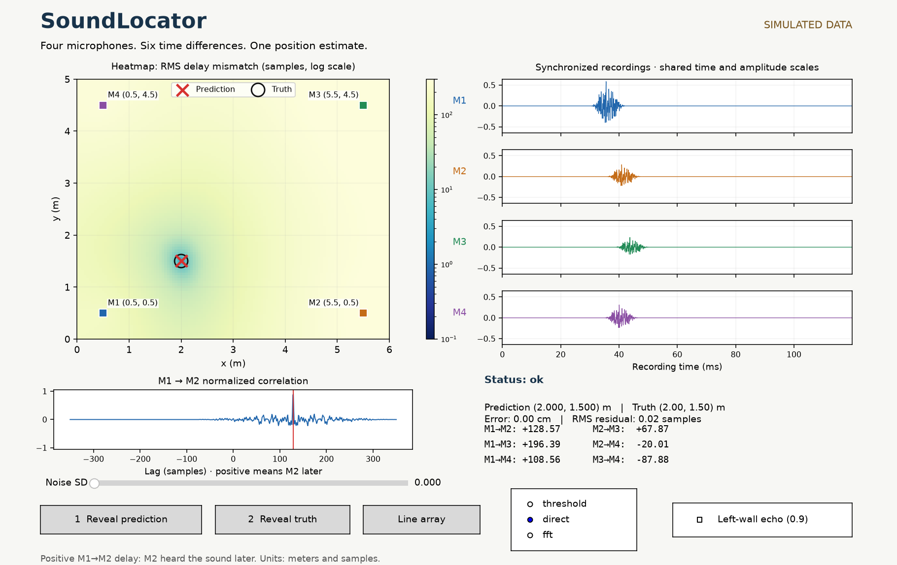

# SoundLocator

This personal project was kept locally on my computer before being uploaded to GitHub for submission. The commit history here starts with that upload.

SoundLocator estimates where a sound came from in a 2D room using four synchronized microphone recordings.

## Why I built this

I started wondering how a sound in my headphones could seem to come from the left or the right. I learned that one clue is timing. If the sound reaches one ear slightly earlier than the other, that small delay can help me tell which side it came from.

That made me wonder if I could use the same idea in reverse. If four microphones pick up the same sound at slightly different times, can I work out where it started? I built a simulator so I could pick a spot in a room, let the program estimate it from the four recordings, and then see how close it got.



## Run

Python **3.12+** and a desktop session are required. From this directory:

```sh
python3 -m venv .venv
.venv/bin/python -m pip install -r requirements.txt
./run.sh
```

Click the room, inspect the four waveforms, click **Reveal prediction**, then
**Reveal truth** to see the error in centimeters. The red cross is the estimate;
the black circle is truth. Dark heatmap areas fit the measured delays better.
Drag a microphone to move it. Try the noise slider, left-wall echo, or **Line
array** to see a case with two mirror solutions. Switching a method keeps the
same recording; changing geometry, noise, or echo generates a new recording.

## Reproduce without the UI

```sh
./run.sh --test
./run.sh evaluate --output scratch/evaluation.json
./run.sh benchmark --output scratch/runtime.json
./run.sh demo --snapshot scratch/demo.png
./run.sh simulate --source 2 1.5 --seed 7 --output scratch/simulated.wav
./run.sh locate scratch/simulated.wav --geometry examples/array.json
./run.sh demo --wav scratch/simulated.wav --geometry examples/array.json
```

For your own WAV, replace the last two paths. Use one synchronized **four-channel
integer PCM WAV** (8/16/24/32 bit, 8–96 kHz, at most 2 seconds), not four separately
started recordings. Edit [array.json](examples/array.json): coordinates are in
meters, and `channel` is the **zero-based WAV channel index**. Microphone order
must match the file. Import does not align channels or infer their positions.
Truth/error is unavailable for imported audio. `locate` returns exit code 0 for
`ok`, 2 for a rejected estimate, and 1 for invalid input.

## What it computes

Direct normalized cross-correlation checks each physically possible lag.
**Positive M1→M2 means M2 heard it later.** The FFT version computes the same
correlation using zero-padding and spectral multiplication. The baseline uses
the first amplitude-threshold crossing. A grid search compares all six measured
delays with distance differences, then refines the best grid point.

The estimator receives only positions, audio, sample rate, and room bounds;
the selected method is its only option. Simulator truth, emission time, source
waveform, and simulated delays never enter it. Silence, narrowband ambiguity,
weak correlations, inconsistent delays, and ambiguous geometry return an
explicit status with **no position**. These checks are heuristics, not guarantees.

## Measured results

32 held-out positions per condition, fixed before evaluation; 480 method/trial
runs. Median / 90th-percentile error in **cm among accepted estimates only**.
Failures are reported separately; all direct/FFT results agree to numerical
precision. These are idealized **simulations**, not measured hardware accuracy.

| Condition | Threshold cm | Failed | Direct / FFT cm | Failed |
|---|---:|---:|---:|---:|
| Clean | 0.40 / 1.58 | 7/32 | 0.03 / 0.04 | 0/32 |
| Noise SD 0.035 | — | 32/32 | 0.05 / 0.11 | 12/32 |
| Wall echo | 0.84 / 5.62 | 14/32 | 0.09 / 0.17 | 5/32 |
| Collinear array | — | 32/32 | — | 32/32 |
| Severe noise SD 0.12 | 139.57 / 249.56 | 18/32 | — | 32/32 |

All 14 accepted threshold estimates in severe noise were wrong by more than
25 cm. Small errors in accepted cases do not imply reliable operation in noise.
See the [full results and observed failures](docs/results.md),
[frozen protocol](docs/protocol.md), and [raw trials](results/evaluation.json).
Runtime is measured separately in [runtime.json](results/runtime.json), excluding
simulation, I/O, and plotting.

## Limits and code

One source, shared clock, known coordinates, constant sound speed (343 m/s),
same source/microphone height, no obstacles. The simulator uses fractional-delay
broadband bursts, independent Gaussian noise, inverse-distance amplitude, and
one reflection from the left wall. It does not model full reverberation, clock
drift, microphone response differences, or realistic 3D acoustics. The sub-mm
clean errors rely on this ideal model and fractional timing; grid refinement is
not a hardware accuracy claim. **No physical microphone recordings were tested.**

- [delays.py](sound_locator/delays.py): threshold, direct NCC, FFT NCC.
- [solver.py](sound_locator/solver.py): grid, score map, ambiguity checks.
- [estimator.py](sound_locator/estimator.py): input boundary and status decisions.
- [simulator.py](sound_locator/simulator.py): synthetic audio and separate truth.
- [demo.py](sound_locator/demo.py), [experiment.py](sound_locator/experiment.py): UI and reproducible experiment.
- [Math and sign example](docs/method.md).

Verified locally on Apple Silicon macOS with Python 3.14.6. Tests include
independent hand-calculated delays, scalar correlation sums, fractional timing,
silence/ambiguity, GUI events, and independently constructed multichannel WAV
input. See [verification](docs/verification.md) for the clean-copy and native UI
checks. Linux, Windows, and physical audio capture were not tested.
